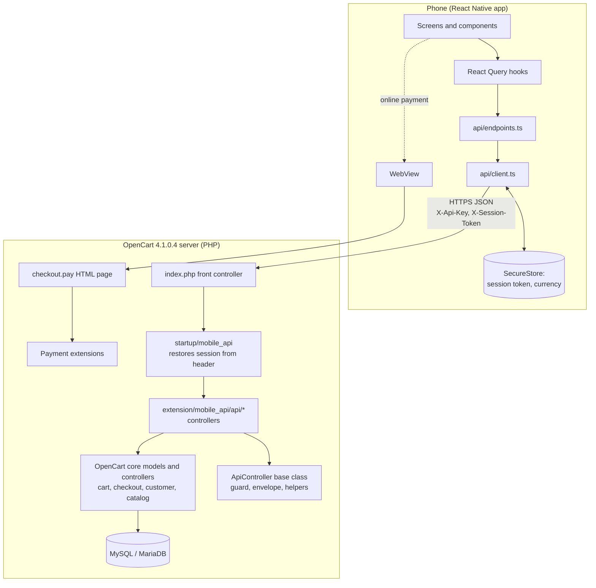
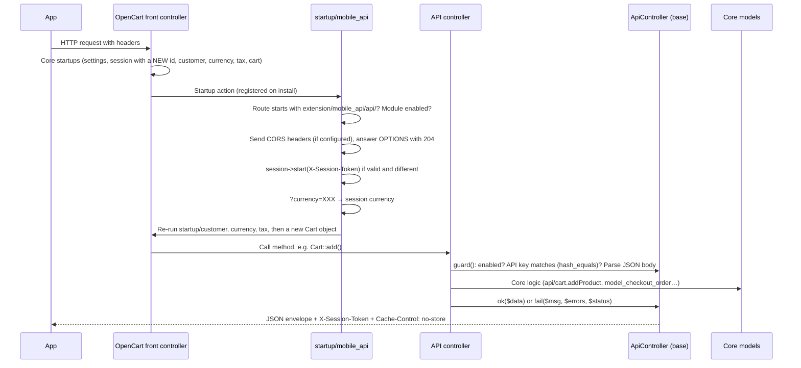
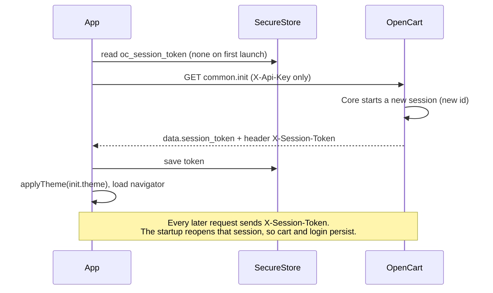
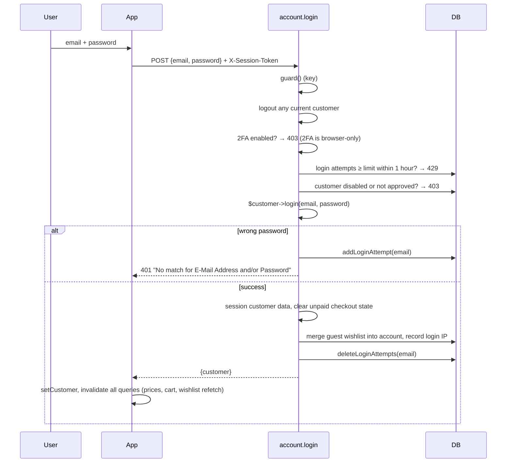
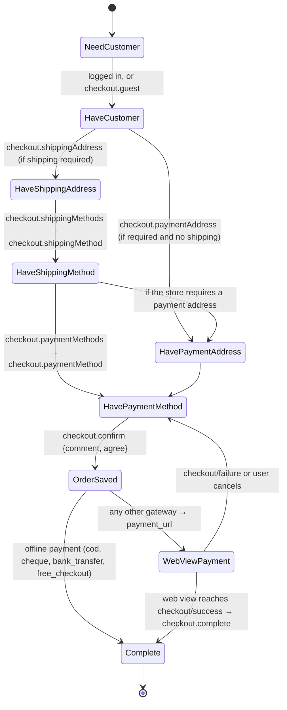
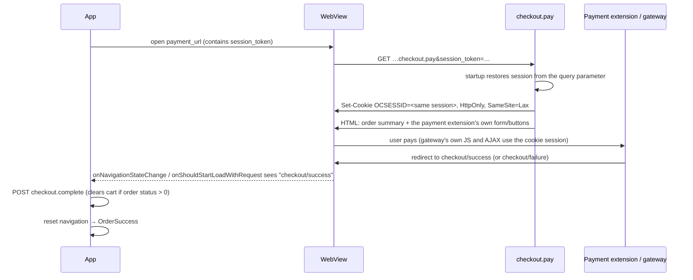

# Developer Guide: OpenCart Mobile App

This guide is for developers who will maintain or extend this project. It covers how the system is built and why. It also covers how each user flow works from start to finish, and how to add features safely.

For installing the extension and running the app the first time, see the [README](../README.md). This guide assumes you have done that.

---

## Contents

1. [What this project is](#1-what-this-project-is)
2. [Architecture at a glance](#2-architecture-at-a-glance)
3. [Repository layout](#3-repository-layout)
4. [Languages](#4-languages)
5. [Tools and libraries, and why each was chosen](#5-tools-and-libraries-and-why-each-was-chosen)
6. [Why Expo](#6-why-expo)
7. [Development environment](#7-development-environment)
8. [The backend: the `mobile_api` OpenCart extension](#8-the-backend-the-mobile_api-opencart-extension)
9. [The mobile app](#9-the-mobile-app)
10. [Design patterns](#10-design-patterns)
11. [Hooks: which ones are used and why](#11-hooks-which-ones-are-used-and-why)
12. [Flows, end to end](#12-flows-end-to-end)
13. [Configuration reference](#13-configuration-reference)
14. [Security measures](#14-security-measures)
15. [Extending the app](#15-extending-the-app)
16. [Checking your changes](#16-checking-your-changes)
17. [Building and releasing](#17-building-and-releasing)
18. [Troubleshooting](#18-troubleshooting)
19. [Known limitations and future work](#19-known-limitations-and-future-work)

---

## 1. What this project is

A native iOS and Android shopping app for an **OpenCart 4.1.0.4** store. It has two parts that ship separately:

| Part | Folder | Runs on | Ships as |
|---|---|---|---|
| **Mobile app** | `mobile/` | Phones (iOS, Android), with web for testing | App Store / Play Store build, or Expo Go during development |
| **Mobile App API extension** | `opencart-extension/mobile_api/` | The OpenCart server (PHP) | `mobile_api.ocmod.zip`, installed via Extensions → Installer |

A local Docker store (`docker-compose.yml`, `store/`) is included for development only.

### Why a custom extension instead of OpenCart's built-in API

OpenCart 4.1.0.4 ships an API (`catalog/controller/api/*`), but it was built for the **admin panel**, not for public clients:

- Only the `api/order` and `api/subscription` routes are allowed.
- Every call needs an HMAC-SHA1 signature with a secret that must stay on the server.
- Calls are limited to whitelisted IP addresses. Phones have changing IPs.
- It **trusts prices posted by the caller**, which is safe for an admin but not for a customer.
- It has no catalog browsing, customer accounts, wishlist, or order history.

So the extension adds a separate set of public JSON endpoints under `extension/mobile_api/api/*`. Wherever possible these call OpenCart's own models and controllers, so stock checks, option validation, taxes, totals, shipping, and payment behave exactly as they do on the website.

---

## 2. Architecture at a glance



Key ideas:

- **The server owns all state.** The cart, checkout progress, login, and wishlist live in the OpenCart **session** on the server. The app is a thin client that renders what the server returns.
- **The session travels in a header.** Native apps don't share the browser's `OCSESSID` cookie, so the app sends `X-Session-Token`. The extension's startup action reopens that session.
- **One response shape.** Every endpoint returns `{success, data, message}` or `{success:false, error, errors}`.
- **Reuse over reimplementation.** Adding to the cart calls core `api/cart.addProduct`. Totals call `api/cart.getTotals`. Offline payments run the payment extension's own `confirm()`. Online gateways render their own forms in a WebView.

---

## 3. Repository layout

```
opencart-mobile-app/
├── README.md                       Setup, API reference, release steps, known limits
├── SECURITY.md                     Vulnerability reporting and production checklist
├── CHANGELOG.md                    Release notes
├── Makefile                        Common tasks (make help)
├── .github/workflows/ci.yml        CI: app checks, PHP 8.0/8.3 lint, extension package
├── .gitignore, .editorconfig, .gitattributes
├── docs/
│   ├── DEVELOPER.md                This guide (the source; edit this file)
│   ├── developer-guide.html        Bootstrap web page built from it (build-html.cjs)
│   ├── developer-guide.wordpress.xml  WordPress import (5 posts) built from it (build-wordpress.cjs)
│   ├── readme-post.wordpress.xml   README.md as one WordPress post with GitHub links (build-readme-post.cjs)
│   └── featured-images/            Featured images for the 5 posts (build.cjs, README.md)
├── docker-compose.yml              Local dev store: web (PHP 8.3 + Apache) and db (MariaDB 11.4)
├── docker/php/Dockerfile           PHP image with gd, mysqli, zip, curl
├── docker/setup-store.sh           `make store`: downloads and installs OpenCart into store/
├── docker/make-host-dynamic.php    Makes the dev store's URLs follow the request's Host header
├── .env.example                    Template for .env: dev store passwords, STORE_BIND_ADDRESS (.env is not committed)
├── store/                          OpenCart 4.1.0.4 install used for local testing (not committed)
│
├── opencart-extension/
│   ├── build.sh                    Packages mobile_api/ into mobile_api.ocmod.zip
│   └── mobile_api/                 Extension source (the folder name is the extension code)
│       ├── install.json            Name, version and description shown in the Installer
│       ├── system/library/
│       │   └── api_controller.php  Base class for every endpoint
│       ├── catalog/controller/
│       │   ├── startup/mobile_api.php   Session, currency and CORS handling for API routes
│       │   └── api/                     One file per resource (see §8.4)
│       └── admin/
│           ├── controller/module/mobile_api.php        Settings page, install and uninstall
│           ├── language/en-gb/module/mobile_api.php    Admin texts
│           └── view/template/module/mobile_api.twig    Settings form
│
└── mobile/                         Expo / React Native app
    ├── App.tsx                     Entry: providers, error boundary, boot screen, theme, lazy navigator
    ├── app.config.ts               Expo config: variants, bundle ids, iOS ATS (dev only), icon, splash, plugins
    ├── eas.json                    EAS Build profiles: development, preview, production
    ├── .env.example                Template for .env: EXPO_PUBLIC_STORE_URL, _API_KEY, _LANGUAGE
    ├── package.json                Dependencies, scripts, Jest config
    ├── eslint.config.js, .prettierrc.json
    ├── tsconfig.json               TypeScript strict mode
    ├── assets/                     icon.png, adaptive-icon.png, splash-icon.png
    ├── scripts/build-icons.cjs     Regenerates the icon and splash images
    └── src/
        ├── config.ts               Store URL, API key, language from env + configProblem() check
        ├── env.d.ts                Types for the build-time environment variables
        ├── __tests__/              Jest unit tests (theme, config, API client)
        ├── theme.ts                Colours, spacing, radius, font sizes, applyTheme()
        ├── api/
        │   ├── client.ts           fetch wrapper: headers, token storage, envelope, ApiError
        │   ├── endpoints.ts        Typed function per endpoint (the `api` object)
        │   └── types.ts            TypeScript types for every response
        ├── context/StoreContext.tsx   Init data, customer, login/logout, currency
        ├── hooks/                  useCart, useWishlist (shared React Query hooks)
        ├── navigation/             RootNavigator (stack + tabs) and param types
        ├── components/             Reusable UI (buttons, fields, product card, address form…)
        ├── screens/                One file per screen (23 screens)
        └── utils/errors.ts         Error message helpers
```

---

## 4. Languages

| Language | Version | Where | Why |
|---|---|---|---|
| **TypeScript** (TSX) | ~6.0 (see `mobile/package.json`), `strict: true` | All app code in `mobile/` | Catches mistakes at compile time, such as a wrong field name in an API response or a wrong navigation parameter. The API types in `src/api/types.ts` and the navigation types in `src/navigation/types.ts` make the compiler check every screen against the server contract. |
| **PHP** | 8.3 in the dev container (OpenCart 4.1.0.4 needs 8.0+) | `opencart-extension/` | OpenCart is written in PHP. An extension has to be PHP to run inside it and call its models. The code uses typed properties, `str_starts_with`, arrow functions and `hash_equals`. |
| **Twig** | OpenCart's bundled version | Admin settings form | OpenCart's admin view layer. |
| **JavaScript / jQuery** | Inside the Twig template | Admin colour pickers | The admin panel already loads jQuery and Bootstrap 5, so small scripts use them. |
| **SQL** | MariaDB 11.4 / MySQL | Only through OpenCart models | The extension writes almost no SQL. It calls core models. The one exception is a `SHOW TABLES` check for the optional bestseller table. |
| **YAML / Dockerfile / shell** | n/a | `docker-compose.yml`, `docker/php/Dockerfile`, `build.sh` | Local dev environment and packaging. |

---

## 5. Tools and libraries, and why each was chosen

### 5.1 Mobile app

| Package | Purpose | Why this one |
|---|---|---|
| **expo** (SDK 58) | Toolchain, native runtime, dev server, build service | See [§6](#6-why-expo). |
| **react** 19.3 / **react-native** 0.88 | UI framework | One code base for iOS and Android with truly native views (not a web page in a wrapper). React is the most widely known UI model, so new developers ramp up fast. The versions are the ones SDK 58 pins; keep them in step with Expo (see §17). |
| **@tanstack/react-query** v5 | Server-state cache: fetching, caching, refetching, pagination, mutations | Almost all app data is *server* state (catalog, cart, orders). React Query gives caching, deduplication, loading and error flags, pull-to-refresh, infinite scroll and cache updates after mutations, with no hand-written reducers. It replaces Redux for this kind of app. |
| **@react-navigation/native**, **native-stack**, **bottom-tabs** v7 | Navigation | The standard for React Native. `native-stack` uses the platform's real navigation controllers (native swipe-back and modal sheets). Navigation parameters are fully typed. |
| **react-native-screens** | Native screen containers | Required by native-stack. Keeps hidden screens out of the render tree to save memory. |
| **react-native-safe-area-context** | Notch and home-indicator insets | Correct padding on every device. Required by React Navigation. |
| **expo-secure-store** | Encrypted key-value storage | Holds the session token, which is effectively a login credential. It uses the iOS Keychain and Android Keystore, unlike AsyncStorage, which is plain text. |
| **react-native-webview** | Embedded browser | Used for (1) store HTML such as product descriptions and information pages, and (2) the **online payment page**, so any OpenCart payment gateway works without writing native code for each one. |
| **@expo/vector-icons** | Icon font (Ionicons) | Bundled with Expo. No image assets to manage. |
| **expo-status-bar** | Status bar style | Switches light or dark icons to match the header colour. |
| **expo-font**, **expo-asset** | Font and asset loading | Needed by the vector icons under SDK 58. |
| **typescript**, **@types/react** | Type checking | See §4. `npm run typecheck` runs `tsc --noEmit`. |
| **expo-splash-screen** | Splash screen | Configured in `app.config.ts`; shows the splash image until the app has loaded. |
| **eslint** + **eslint-config-expo**, **prettier** | Lint and formatting | Expo's recommended rules, including the React Hooks rules (which caught several effects that copied server data into state). One formatting style for everyone. |
| **jest** + **jest-expo**, **@types/jest** | Unit tests | `jest-expo` mocks the native modules, so logic such as the colour maths and the API client can be tested in Node. |
| **@babel/core** | Transpiler used by Metro | Required by Expo's bundler. |

Deliberately **not** used:

- **Redux / Zustand.** React Query plus one small Context covers it. Adding a global store would duplicate server state and invite stale data.
- **Axios.** `fetch` is built in. All HTTP lives in one 150-line file (`client.ts`), so a library adds nothing.
- **A UI kit (NativeBase, Paper…).** A small set of components in `components/ui.tsx` keeps the bundle small and the look fully under the store's control, including the admin-set colours.
- **Form libraries.** Forms are small. `useState` plus field errors from the server is enough, and the server is the source of truth for validation.

### 5.2 Backend and dev environment

| Tool | Purpose | Why |
|---|---|---|
| **OpenCart 4.1.0.4 extension system** | Packaging and install | Installs through the admin UI with no core file edits, so OpenCart upgrades don't overwrite it. Uninstalling removes it cleanly. |
| **OpenCart startup actions** | Run code on every catalog request | The supported hook point for swapping the session before controllers run (see §8.3). No core edits. |
| **Docker Compose** (php:8.3-apache, mariadb:11.4) | Local store | The same environment on every machine. The store runs on port 8090 because 8080, 8081 and 3307 were already taken on the original dev machine. |
| **zip** (`build.sh`) | Packaging | OpenCart's installer expects a `.ocmod.zip` whose contents sit at the root. The zip's file name becomes the extension code. |

---

## 6. Why Expo

Expo is a framework and toolchain on top of React Native. For this project it was the right choice for these reasons:

1. **No native toolchain to start.** You can develop on a real phone with only Node.js and the free **Expo Go** app: run `npx expo start` and scan the QR code. No Xcode or Android Studio is needed until you make a store build. Backend developers who mostly know PHP can still run and debug the app.
2. **One code base, both platforms, plus web.** The same TypeScript runs on iOS and Android. `npx expo start --web` runs it in a browser, which is handy for quick API debugging. `client.ts` and `PaymentScreen` include small web fallbacks.
3. **Versioned, tested native modules.** Each SDK release pins versions of React Native and its modules (SecureStore, WebView, screens…) that are tested together. `npx expo install <pkg>` picks the matching version, which avoids the usual native dependency conflicts.
4. **Cloud builds and store submission (EAS).** `eas build` produces signed `.ipa` and `.aab` files on Expo's servers, so you don't need a Mac for iOS builds. `eas submit` uploads them to the stores.
5. **Over-the-air updates (EAS Update).** You can push JavaScript-only fixes, such as a text change or a bug in a screen, to installed apps without a store review. Native changes still need a new build.
6. **Config plugins instead of editing native projects.** Native settings, such as iOS App Transport Security (`NSAllowsLocalNetworking`) or the SecureStore setup, are declared in `app.config.ts`. Expo generates the iOS and Android projects (`expo prebuild`), so there are no `ios/` or `android/` folders to maintain.
7. **Fast iteration.** Fast Refresh keeps app state while you edit. `npx expo start -c` clears the bundler cache when things get confused.

Trade-offs to know about:

- **Expo Go supports only the newest SDK.** That is why the project was upgraded to SDK 58: the App Store version of Expo Go showed "No usable data" for an older SDK QR code. If you add a library with custom native code that isn't in Expo Go, switch to a **development build** (`npx expo run:ios` or `eas build --profile development`).
- You follow Expo's upgrade cadence (about three SDKs a year). See §17 for how to upgrade.

---

## 7. Development environment

### 7.1 Prerequisites

- **Node.js 20 or newer** (the project has been run with Node 26).
- **Docker Desktop**, for the local store.
- **Expo Go** on your phone, or Xcode (iOS Simulator) or Android Studio (emulator).
- The phone and computer on the **same Wi-Fi network**.

### 7.2 Start the store

```bash
cd opencart-mobile-app
cp .env.example .env                 # set the passwords
make store                           # first time only: downloads OpenCart 4.1.0.4 into store/ and installs it
docker compose up -d                 # later: start it (web on :8090, db internal only)
open http://localhost:8090/          # storefront
open http://localhost:8090/admin/    # admin (credentials in .env)
```

`make store` runs `docker/make-host-dynamic.php`, so `store/config.php` and `store/admin/config.php` build `HTTP_SERVER` from the request's `Host` header. The same store therefore works at `localhost:8090` on your computer and at `<your LAN IP>:8090` from the phone, and image URLs always point at an address the client can reach.

The port is bound to `${STORE_BIND_ADDRESS:-127.0.0.1}`, so by default only this computer can reach the store. To test on a real phone, set `STORE_BIND_ADDRESS=0.0.0.0` in `.env` and run `docker compose up -d` again. **Anyone on your Wi-Fi can then open the dev store and its admin**, so don't do this on a public network.

### 7.3 Start the app

```bash
cd mobile
npm ci
cp .env.example .env     # then edit it (below)
npx expo start -c        # -c clears the Metro cache; use it after changing .env or dependencies
```

Scan the QR code with the iPhone Camera (it opens Expo Go) or from inside Expo Go on Android.

In `mobile/.env`, set `EXPO_PUBLIC_STORE_URL` to your computer's LAN IP, e.g. `http://192.168.0.10:8090/`. Find it with `ipconfig getifaddr en0` on macOS. **`localhost` on a phone means the phone itself.** For the Android emulator use `http://10.0.2.2:8090/`. Set `EXPO_PUBLIC_API_KEY` to the key on the module settings page. If either is missing or invalid, the app's start screen says which one.

### 7.4 Useful commands

| Command | Where | What it does |
|---|---|---|
| `make help` | root | Lists the Makefile tasks (`up`, `down`, `extension`, `php-lint`, `mobile-check`, `docs`, `check`…) |
| `make check` | root | Everything CI runs: PHP lint (in Docker) and the app checks |
| `npm run check` | `mobile/` | Type-check, lint, format check and unit tests |
| `npm run typecheck` / `lint` / `format` / `test` | `mobile/` | The individual steps |
| `npx expo start -c` | `mobile/` | Dev server with a clean cache |
| `npx expo export --platform ios` | `mobile/` | Builds a production JS bundle; a quick way to catch bundling errors |
| `npx expo-doctor` | `mobile/` | Checks dependency versions against the SDK |
| `make extension` | root | Lints the PHP and builds `mobile_api.ocmod.zip` (the zip is not committed) |
| `make docs` | root | Rebuilds the HTML guide and the WordPress import (the import needs Chrome for the diagrams) |
| `docker compose exec web php -l extension/mobile_api/<file>` | root | PHP syntax check inside the container |
| `docker compose logs -f web` | root | Apache and PHP errors |

### 7.5 Editing the extension locally

The source of truth is `opencart-extension/mobile_api/`. The running store uses its installed copy in `store/extension/mobile_api/`. After editing, either copy the changed file across:

```bash
cp opencart-extension/mobile_api/catalog/controller/api/cart.php store/extension/mobile_api/catalog/controller/api/cart.php
```

…or rebuild the zip and reinstall it through the admin. **Reinstalling resets the module settings, including the API key**, so the copy approach is faster during development. Always commit the source folder, not the `store/` copy.

---

## 8. The backend: the `mobile_api` OpenCart extension

### 8.1 How a request reaches an endpoint

The app calls URLs such as:

```
GET  {baseUrl}index.php?route=extension/mobile_api/api/product.info&product_id=40&language=en-gb&currency=USD
POST {baseUrl}index.php?route=extension/mobile_api/api/cart.add      (JSON body)
Headers: X-Api-Key: <key>   X-Session-Token: <token>   Content-Type: application/json
```

OpenCart's router maps `extension/mobile_api/api/product.info` to the class `Opencart\Catalog\Controller\Extension\MobileApi\Api\Product` in `extension/mobile_api/catalog/controller/api/product.php`, and calls its `info()` method. The part after the dot is the method name.



### 8.2 The base class: `system/library/api_controller.php`

Every endpoint class extends `Opencart\System\Library\Extension\MobileApi\ApiController`. It provides:

| Method | What it does |
|---|---|
| `guard(): bool` | Must be the first call in every public method. Fails with **503** if the module is disabled and **401** if `X-Api-Key` doesn't match, using constant-time `hash_equals`. Then it merges a JSON body into `$this->request->post`. |
| `guardCustomer(): bool` | `guard()`, plus **401** "Please log in to continue." when no customer is logged in. Used by account, address and order endpoints. |
| `parseJsonBody()` | Reads `php://input` when `Content-Type` is `application/json` and runs it through `$this->request->clean()`, the same HTML escaping OpenCart applies to form posts. Core code that reads `$this->request->post` then works unchanged. |
| `post($key, $default)`, `query($key, $default)` | Read POST or GET values. |
| `ok(array $data, string $message = '')` | Sends `{"success":true,"data":{…},"message":"…"}`. An empty array is sent as `{}`, so clients always get an object. |
| `fail(string $message, array $errors = [], int $status = 400)` | Sets the HTTP status and sends `{"success":false,"error":"…","errors":{"field":"message"}}`. |
| `output()` (private) | Adds `Content-Type: application/json`, `Cache-Control: no-store` and **`X-Session-Token`** (the session actually used) to every response. |
| `decode($s)`, `t($key)` | OpenCart stores text HTML-escaped (`&amp;`). Native clients need plain text, so every outgoing string is decoded. `t()` reads a language key and decodes it. |
| `canSeePrice()` | False when "Login to see prices" (`config_customer_price`) is on and nobody is logged in. Every price output respects it. |
| `formatPrice($value, $tax_class_id)` | Adds tax according to the store's display setting and formats it in the session currency. |
| `image($path, $w, $h)` | Absolute URL of a resized image (cached by OpenCart), or the placeholder image. The default size comes from the module settings. |
| `productCard($row)` | The single compact product shape used by **every** list: home, category, search, wishlist and related products. |
| `validateAddress()`, `buildSessionAddress()`, `addressPayload()` | Shared address rules (the same as `account/address`), the address array that checkout keeps in the session, and the address shape sent to the client. |

**Response envelope**

```jsonc
// success
{ "success": true, "data": { "cart": "…" }, "message": "Success: You have added …" }

// failure (HTTP 4xx/5xx)
{ "success": false, "error": "E-Mail Address does not appear to be valid!",
  "errors": { "email": "E-Mail Address does not appear to be valid!", "telephone": "…" } }
```

Status codes used: `400` bad request, `401` bad key or not logged in, `403` not allowed (disabled feature, 2FA on, account not approved), `404` not found, `409` conflict (empty cart, already logged in), `422` validation errors, `429` too many login attempts, `500` order creation failed, `503` API disabled.

### 8.3 The startup: `catalog/controller/startup/mobile_api.php`

**Why it exists.** When a request arrives, OpenCart's core startups have already started a session from the `OCSESSID` cookie. A phone sends no cookie, so that would be a brand-new, empty session on every request: no cart and no login. The startup fixes this by reopening the session the app asks for.

**What it does, in order** (and only for routes starting with `extension/mobile_api/api/`):

1. Returns early if the module is disabled.
2. Sends CORS headers if a **CORS Origin** is configured. This is only needed for Expo web. It answers `OPTIONS` preflight requests with `204`.
3. Takes the token from `X-Session-Token`. For `checkout.pay` only, it takes it from the `session_token` query parameter instead, because a WebView's first page load can't send custom headers.
4. If the token matches `^[a-zA-Z0-9]{26,52}$` and differs from the current id, it calls `$this->session->start($token)`.
5. If `?currency=` is a valid enabled currency, it stores it in the session.
6. If anything changed, it re-runs `startup/customer`, `startup/currency` and `startup/tax` (the same order as `system/config/catalog.php`) and replaces the `cart` object. The logged-in customer, currency and tax rates then match the restored session.

The startup is registered by `install()` in the admin controller and removed by `uninstall()`. You can see it under **System → Settings → Startups** (code `mobile_api`).

### 8.4 Endpoint files

| File | Methods | Auth |
|---|---|---|
| `common.php` | `init`: store info, theme colours, settings, currencies, languages, customer, session token | key |
| `catalog.php` | `home`, `categories`, `category`, `manufacturers`, `informations`, `information` | key |
| `product.php` | `index` (list, search, filter, sort, paginate), `info` (full detail), `reviews`, `review` (write) | key |
| `cart.php` | `index`, `add`, `edit`, `remove`, `clear`, `coupon` | key |
| `wishlist.php` | `index`, `add`, `remove` (session list for guests, database for customers) | key |
| `account.php` | `login`, `logout`, `register`, `forgotten`, `profile`, `edit`, `password`, `newsletter` | key; profile, edit, password and newsletter need login |
| `address.php` | `index`, `save` (create or update), `delete` | login |
| `order.php` | `index`, `info`, `reorder` | login |
| `localisation.php` | `countries`, `zones` | key |
| `checkout.php` | `index`, `guest`, `shippingAddress`, `paymentAddress`, `shippingMethods`, `shippingMethod`, `paymentMethods`, `paymentMethod`, `confirm`, `pay` (HTML), `complete` | key; checkout steps need a customer (logged in or guest) in the session |

The full parameter list is in the README's **API reference**.

### 8.5 The admin module: `admin/controller/module/mobile_api.php`

- `index()` renders the settings form (`mobile_api.twig`). It generates a 40-character API key if none exists and shows the API base URL for testing.
- `save()` checks permission, validates the key (`^[a-zA-Z0-9]{20,64}$`) and each colour (`^#[0-9a-fA-F]{6}$` or empty), normalises the featured product IDs, and saves everything under the setting code `module_mobile_api`. **`editSetting` replaces the whole group**, so every field must be posted together. The form already does this.
- `install()` registers the startup and writes default settings (status off and a random key).
- `uninstall()` removes the startup and all `module_mobile_api_*` settings.

Errors are returned as `{"error": {"color_primary": "…"}}`. OpenCart's admin JavaScript highlights `#input-color-primary` and fills `#error-color-primary` (underscores become dashes).

---

## 9. The mobile app

### 9.1 Layers

```
Screens (src/screens)          what the user sees; compose components; call hooks
   │
Components (src/components)    reusable UI: Button, TextField, ProductCard, AddressForm, …
   │
Hooks + Context                React Query hooks (useCart, useWishlist, inline useQuery/useMutation)
   │                           StoreContext (init data, customer, login/logout, currency)
Endpoints (src/api/endpoints)  one typed function per server endpoint
   │
Client (src/api/client)        fetch, headers, token storage, envelope unwrap, ApiError
```

Rules that keep this clean:

- **Screens never call `fetch`.** They call `api.*` through React Query.
- **Only `client.ts` knows about headers, tokens and the envelope.**
- **Types live in `api/types.ts`** and mirror the PHP output exactly. Change both together.

### 9.2 Start-up sequence (`App.tsx`)

```
App
└─ SafeAreaProvider
   └─ QueryClientProvider        (staleTime 60 s, retry 1)
      └─ ErrorBoundary           crash screen with "Try again" instead of a blank app
         └─ StoreProvider        calls api.common.init() once on mount
            └─ Bootstrap
                loading  → BootScreen (spinner)
                error    → BootScreen (message + Try again → reload())
                ready    → loadNavigator(init.theme):
                             applyTheme(init.theme)
                             require('./src/navigation/RootNavigator')   ← loaded only now
                           <NavigationContainer theme={navTheme}>
                             <StatusBar style=light|dark />
                             <RootNavigator/>
```

**Why the navigator is `require()`d late:** each screen builds its styles with `StyleSheet.create()` when its module first loads, and that copies the colour values at that moment. The store's colours must be in `colors` *before* any screen module loads. `App.tsx` therefore deliberately imports nothing that creates styles; even the boot screen uses inline styles. **Don't add imports of screens or components to `App.tsx`.** The side effect is that a colour change in the admin shows up on the next app launch, not live.

### 9.3 API client (`src/api/client.ts`)

- **`request<T>(route, {method, query, body})`** is the only way the app talks to the server.
  - Adds `Accept`, `X-Api-Key`, `X-Session-Token` (if one is stored) and `Content-Type: application/json` for POST.
  - Builds the URL with `buildUrl()`: `route=extension/mobile_api/api/<route>`, `language`, the stored `currency`, and any query parameters (empty values are dropped).
  - Sends `credentials: 'omit'`, so no cookies are used; the header is the only session carrier.
  - Aborts a request after **20 seconds** with "The store is taking too long to respond", so a dead connection never leaves a spinner forever.
  - Refuses to send anything while `configProblem()` reports a missing or invalid store URL or API key, and throws that message instead. The boot screen shows it.
  - **Reads `X-Session-Token` from every response** and stores it if it changed. This is how a new install gets its first session, and how it recovers when the server's session expired and a new one was created.
  - Unwraps the envelope. On `success:false` it throws **`ApiError(message, status, errors)`**. A network failure becomes `ApiError(…, 0)`. A non-JSON response (a PHP error, or the extension not installed) gets a helpful message.
- **Storage:** `expo-secure-store` on device, `localStorage` on web. Keys are `oc_session_token` and `oc_currency`. The values are loaded once (`ensureLoaded`) and then kept in memory.

### 9.4 Endpoints and types

`src/api/endpoints.ts` exports one object:

```ts
api.cart.add({ product_id: 40, quantity: 1, option: { 218: '5' } })  // Promise<Cart>
api.checkout.confirm({ comment: '', agree: true })                  // Promise<ConfirmResult>
```

Grouping by resource mirrors the PHP files, so `api.cart.*` maps to `cart.php`. The return types come from `src/api/types.ts`.

### 9.5 State management

| Kind of state | Where it lives | Examples |
|---|---|---|
| **Server state** (the large majority) | React Query cache | catalog, product, cart, wishlist, orders, addresses, checkout state |
| **App-wide session state** | `StoreContext` | `init` (store, settings, currencies, theme), `customer`, `isLoggedIn`, `login()`, `logout()`, `changeCurrency()`, `reload()` |
| **Screen-local UI state** | `useState` | form fields, selected options, quantity, search text, image carousel index |
| **Persisted** | SecureStore | session token, currency |

**Query keys in use** (keep new ones consistent):

| Key | Data |
|---|---|
| `['home']` | Home sections |
| `['categories', parentId]`, `['category', id]` | Category tree and details |
| `['products', query]` | Product lists (infinite) |
| `['product', id]` | Product details |
| `['reviews', productId]` | Reviews (infinite) |
| `['cart']` (`cartKey`) | Cart |
| `['wishlist']` (`wishlistKey`) | Wishlist |
| `['profile']`, `['addresses']`, `['orders']`, `['order', id]` | Account |
| `['countries']`, `['zones', countryId]` | Localisation (`staleTime: Infinity`) |
| `['informations']`, `['information', id]` | Information pages |
| `['checkout', 'state']`, `['checkout', 'shipping', addr]`, `['checkout', 'payment', method, addr]` | Checkout |

**Cache rules used across the app:**

- Mutations that return the full cart (`add`, `edit`, `remove`, `coupon`) **write the response straight into `['cart']`** with `setQueryData`. There's no extra refetch, and the tab badge updates instantly. They also invalidate `['checkout']`, because the totals changed.
- After **login**, `queryClient.invalidateQueries()` refetches everything, because prices, cart (merged with the account cart) and wishlist can all change.
- After **logout**, `queryClient.clear()` drops all cached data, so nothing from the previous customer stays visible.
- After **currency change**, init reloads and everything is invalidated, so prices refetch in the new currency.
- After an **order is placed**, `['cart']` is invalidated and every `['checkout', …]` query is removed.

### 9.6 Navigation

`src/navigation/RootNavigator.tsx`:

```
Stack (native-stack)
├─ Tabs (bottom-tabs, header hidden on the stack)
│   ├─ Home         (own header inside the screen)
│   ├─ Categories
│   ├─ Cart         (badge: cart count)
│   ├─ Wishlist     (badge: wishlist count)
│   └─ Account
├─ Product, ProductList, Search, Reviews
├─ WriteReview, Login, Register              (presentation: 'modal')
├─ ForgotPassword
├─ Checkout, Payment (no swipe-back), OrderSuccess (no back)
├─ Orders, OrderDetail, Addresses, AddressEdit, EditProfile, ChangePassword
└─ Information
```

Every route's parameters are typed in `src/navigation/types.ts` (`RootStackParamList`, `TabParamList`). Screens get typed props with `NativeStackScreenProps<RootStackParamList, 'Product'>`. Components use `useNavigation<NativeStackNavigationProp<RootStackParamList>>()`. A typo in a route name or a missing parameter fails `tsc`.

Header and tab bar colours come from `colors.tertiary` and `colors.onTertiary`. The active tab uses `colors.primary` (white on a dark tertiary).

### 9.7 Theme (`src/theme.ts`)

- `colors`, `spacing`, `radius` and `font` are the only places style constants should come from. Don't hard-code hex values in screens.
- `applyTheme(init.theme)` overrides colours from the admin and derives the rest:

| Admin setting | `colors` fields set | Derived |
|---|---|---|
| Primary | `primary` | `primaryDark` (25 % black), `primarySoft` (90 % white), `onPrimary` (contrast text) |
| Secondary | `secondary` | `onSecondary` |
| Tertiary | `tertiary` | `onTertiary`, `tertiaryIsDark` (controls the status bar style) |
| Font | `text` | `textMuted` (35 % lighter); also `onTertiary` on light headers |
| Button | `button` (falls back to `primary`) | n/a |
| Button text | `onButton` (falls back to automatic contrast) | n/a |

The contrast choice (`readableOn`) uses the WCAG relative-luminance formula and picks whichever of white or near-black has the higher contrast ratio. `accent` (red) is reserved for errors and destructive actions and **can't** be changed from the admin, so errors always look like errors.

### 9.8 Components (`src/components`)

| Component | Use |
|---|---|
| `ui.tsx` | `Button` (variants: primary, secondary, outline, ghost, danger; `loading`, `icon`, `small`), `TextField` (label, error), `Card`, `Row`, `SectionHeader`, `Chip`, `Checkbox`, `RadioRow`, `ListItem`, `Badge` |
| `States.tsx` | `Loading`, `ErrorState` (with retry), `EmptyState` (with action) |
| `Price.tsx` | `Price` (normal and special price), `Rating` (stars) |
| `ProductCard.tsx` | Grid card: image, sale badge, wishlist heart, price |
| `ProductGrid.tsx` | Two-column `FlatList` with infinite-scroll footer |
| `ProductResults.tsx` | `useInfiniteQuery` around `api.product.list` plus a sort bar; used by ProductList and Search |
| `ProductOptions.tsx` | Renders every OpenCart option type (select, radio, checkbox, text, textarea, date, time, datetime). File options show a notice instead. |
| `QuantityStepper.tsx` | − / + control with a minimum |
| `SelectModal.tsx` | Searchable picker in a modal (countries, zones, option values) |
| `AddressForm.tsx` | Address fields with country and zone pickers (loads zones when the country changes) |
| `HtmlView.tsx` | Renders store HTML in an auto-sized WebView; links open in the system browser |

### 9.9 Screens (`src/screens`)

| Screen | Data | Notes |
|---|---|---|
| Home | `['home']` | Logo or name, search box, banner carousel, category row, featured, specials, latest, bestsellers |
| Categories | `['categories', 0]` | Expandable tree → ProductList |
| ProductList | `ProductResults` | Category, manufacturer or specials, with sort |
| Search | `ProductResults` | 400 ms debounce before querying |
| Product | `['product', id]` | Gallery, price and discounts, options, subscriptions, quantity, add to cart, wishlist, attributes, description, related products, reviews link |
| Reviews, WriteReview | `['reviews', id]` | Infinite list; the write form validates on the server |
| Cart | `useCart` | Edit quantity, remove, coupon, totals, stock warnings, checkout button |
| Wishlist | `useWishlist` | Grid of saved products |
| Account | `StoreContext`, `['profile']` | Login prompt or profile, newsletter switch, links, currency picker, information pages, logout |
| Login, Register, ForgotPassword | n/a | Modal screens; can redirect back to Checkout |
| Checkout | `['checkout', …]` | Step-by-step on one screen (see §12.7) |
| Payment | n/a | WebView for online gateways |
| OrderSuccess | n/a | Confirmation; the back stack is reset |
| Orders, OrderDetail | `['orders']`, `['order', id]` | History, status timeline, reorder an item |
| Addresses, AddressEdit | `['addresses']` | Address book with set-default |
| EditProfile, ChangePassword | n/a | Account forms |
| Information | `['information', id]` | CMS pages (About, Terms…) |

---

## 10. Design patterns

| Pattern | Where | Why |
|---|---|---|
| **Backend for Frontend (BFF)** | The `mobile_api` extension | Endpoints are shaped for the app's screens (`catalog.home` returns all home sections in one call, `productCard` is a ready-to-render shape), so the app makes fewer, simpler calls. |
| **Template Method / base class** | `ApiController` | Shared steps (guard, envelope, decoding, price and image helpers) live in one place. Each endpoint only writes its own logic. |
| **Guard clause** | `if (!$this->guard()) return;` at the top of every method | Authentication can't be forgotten in the middle of a method, and failure paths exit early. |
| **Adapter / delegation to core** | `cart.add` → `api/cart.addProduct`, totals → `api/cart.getTotals`, offline payments → `extension/opencart/payment/<code>.confirm` | Reuses OpenCart's tested logic, so every installed shipping, payment and total extension works without changes. |
| **Middleware / interceptor** | Startup action (server); `request()` (client) | Cross-cutting concerns (session, currency, CORS, headers, token persistence, error mapping) handled once, outside the business code. |
| **Uniform response envelope** | `ok()` / `fail()` ↔ `request()` | One parser on the client. Field errors map straight onto form fields. |
| **Server-authoritative state** | Cart, checkout, prices | The client never computes prices or totals; it displays what the server returns. This prevents price tampering and keeps the app and website consistent. |
| **State machine in the session** | Checkout | Each step stores its result in the session (`customer` → addresses → `shipping_method` → `payment_method` → `order_id`). Changing an earlier step clears the later ones, so the order is always built from a valid sequence. |
| **Repository / service module** | `api/endpoints.ts` | One typed function per endpoint. Screens don't know URLs. |
| **Provider / Context** | `StoreProvider` | App-wide session data without prop drilling. |
| **Custom hooks** | `useCart`, `useAddToCart`, `useToggleWishlist`, `useStore` | Encapsulate cache keys and update rules, so every screen updates the cart in the same way. |
| **Cache-aside with write-through on mutation** | `useCartMutation` → `setQueryData` | Mutations return fresh server data and put it straight into the cache. |
| **Container / presentational split** | Screens fetch; components such as `ProductCard`, `Price` and `AddressForm` mostly receive props | Components are reusable and easy to reason about. |
| **Lazy module loading** | `require()` of the navigator in `App.tsx` | Lets runtime theme values apply to module-level styles. |
| **Typed contracts** | `types.ts`, `navigation/types.ts` | Compile-time checking of the API and navigation contract. |

---

## 11. Hooks: which ones are used and why

### 11.1 React built-in hooks

| Hook | Used for | Example |
|---|---|---|
| `useState` | Local UI state: form fields, selected options, quantity, field errors, search text, carousel index, WebView height | `const [code, setCode] = useState('')` in CartScreen |
| `useEffect` | Syncing with something outside render: search debounce (`setTimeout`), filling the coupon field when the cart loads, loading init on mount | SearchScreen waits 400 ms after typing before setting the query term |
| `useLayoutEffect` | Setting header buttons before the first paint so they don't flicker | PaymentScreen's "Cancel" header button |
| `useMemo` | Stable derived values: the Context value object, the navigation theme | Stops every consumer of `useStore()` re-rendering on each parent render |
| `useCallback` | Stable function identities in the Context (`reload`, `login`, `logout`, `changeCurrency`) | So the `useMemo` above stays stable |
| `useRef` | A mutable flag that must not trigger a render | `finished` in PaymentScreen stops completing the order twice when several WebView events fire |
| `useContext` | Reading `StoreContext` (wrapped by `useStore`) | n/a |

### 11.2 React Query hooks

| Hook | Used for | Why |
|---|---|---|
| `useQuery` | Every read: home, product, cart, wishlist, orders, addresses, countries, checkout state | Caching, loading and error flags, refetch, `enabled` for dependent queries (e.g. shipping methods only after there is a shipping address) |
| `useInfiniteQuery` | Product lists, reviews, orders | Page-based infinite scroll with `getNextPageParam: last.page < last.pages ? last.page + 1 : undefined` |
| `useMutation` | Every write: add to cart, login, save address, confirm order… | `isPending` for button spinners, `onSuccess` to update the cache, `onError` to show errors |
| `useQueryClient` | Manual cache work: `setQueryData`, `invalidateQueries`, `removeQueries`, `clear` | See the cache rules in §9.5 |

### 11.3 React Navigation hooks

| Hook | Used for |
|---|---|
| `useNavigation` | Navigating from components that aren't screens, or from tab screens to stack screens |
| Screen props (`route`, `navigation`) | Reading typed parameters and calling `navigate`, `replace`, `reset` and `setOptions` |

### 11.4 Custom hooks in this project

| Hook | File | What it gives you |
|---|---|---|
| `useStore()` | `context/StoreContext.tsx` | `init`, `customer`, `isLoggedIn`, `loading`, `error`, `reload`, `login`, `logout`, `setCustomer`, `changeCurrency`. Throws if used outside the provider. |
| `useCart()` | `hooks/useCart.ts` | The cart query (`['cart']`) |
| `useCartCount()` | `hooks/useCart.ts` | Number of items, for the tab badge |
| `useAddToCart()`, `useUpdateCartItem()`, `useRemoveCartItem()`, `useApplyCoupon()` | `hooks/useCart.ts` | Cart mutations built on the private `useCartMutation` helper. Each writes the returned cart into the cache and invalidates checkout. |
| `useWishlist()` | `hooks/useWishlist.ts` | The wishlist query (`['wishlist']`), which includes `product_ids` for quick lookups |
| `useToggleWishlist()` | `hooks/useWishlist.ts` | `isInWishlist(id)`, `toggle(id)`, `toggleAsync(id)`, `isPending`. Adds or removes depending on the current state and writes the result into the cache. |

**Rule of thumb:** if two or more screens read or change the same server data, put the query key and the update rule in a hook in `src/hooks/`. If only one screen uses it, an inline `useQuery` or `useMutation` is fine.

---

## 12. Flows, end to end

### 12.1 First launch and session creation



If the session expires on the server (System → Settings → Server → session lifetime), the server silently starts a new one. The response header carries the new id and `client.ts` stores it. The user then appears as a logged-out guest with an empty cart. This is the same as on the website.

### 12.2 Browsing

- **Home** calls `catalog.home` once. It returns banners (from the banner chosen in the module settings), top-level categories, featured products (IDs from settings), latest, specials, and bestsellers (only if the core Bestseller module's table exists).
- **Category → product list** calls `product.index` with `category_id`, `sub_category=1`, `sort`, `page` and `limit`. `useInfiniteQuery` loads the next page when you scroll near the end.
- **Search** debounces typing by 400 ms, then calls `product.index&search=…`.
- **Product** calls `product.info`. It returns images, price, special and quantity discounts (with tax applied according to store settings), options (variants inherit their master's options), subscription plans, attributes, related products, review summary, stock text and the wishlist flag.
- Prices are empty strings when the store requires login to see prices and nobody is logged in.

### 12.3 Authentication

**Model:** login is **session-based**, exactly like the website. There is no separate JWT. Logging in marks the server-side session (the one identified by `X-Session-Token`) as belonging to the customer. The token is stored in SecureStore, so the customer stays logged in across app restarts until the session expires or they log out.



- **Cart merge:** OpenCart's cart table is keyed by session id and customer id. After login, core `Cart` loads the customer's saved cart together with the guest session's cart, as on the website.
- **Register** (`account.register`) validates with the same rules and language strings as the website: name lengths, email format and uniqueness, telephone (if required), password length and complexity from store settings, and the account terms checkbox if a terms page is set. If the customer group requires **approval**, it returns `{approval: true, customer: null}` and the app shows a message instead of logging in. Otherwise it logs the customer in straight away.
- **Logout** (`account.logout`) calls `$customer->logout()` and removes the same session keys as the website's logout. The app then calls `queryClient.clear()`.
- **Forgotten password** (`account.forgotten`) creates a reset token through the core model, which triggers the core email. It returns **the same message whether or not the email exists**, so it can't be used to find out which emails have accounts.
- **Change password** (`account.password`) requires the current password.
- **Login-gated screens:** endpoints protected by `guardCustomer()` return 401. The app shows a login prompt on the Account tab. Login and Register accept `redirect: 'Checkout'` and return the user to checkout afterwards.

### 12.4 Cart

| Action | Endpoint | Server behaviour |
|---|---|---|
| Add | `cart.add {product_id, quantity, option, subscription_plan_id}` | Delegates to core `api/cart.addProduct`: checks the product exists and is enabled, validates required options, option values, variants, minimum quantity and subscription plan. Then resets checkout methods. |
| Edit quantity | `cart.edit {key, quantity}` | Updates the line; quantity 0 or less removes it |
| Remove | `cart.remove {key}` | n/a |
| Coupon | `cart.coupon {coupon}` | Validated by the core coupon total extension; an empty string removes it |
| View | `cart.index` | Lines (options, stock flag, minimum check, subscription text), totals from `api/cart.getTotals`, weight, warnings, `can_checkout` |

Each response is the **full cart**. The hooks write it into the cache, so the cart screen and the tab badge update without another request.

**Option format:** `option` is an object keyed by `product_option_id`. Select and radio options take one `product_option_value_id`. Checkbox options take an array of IDs. Text, textarea, date, time and datetime options take a string.

### 12.5 Wishlist

- **Guest:** product IDs are kept in `session['wishlist']`.
- **Customer:** stored in the database through `model_account_wishlist`.
- **On login:** the guest list is moved into the account.
- Every endpoint returns `{products, product_ids}`. `useToggleWishlist` uses `product_ids` to decide between add and remove.

### 12.6 Addresses

`address.save` validates through `validateAddress()`, which applies the same rules as the website: postcode required per country, zone required if the country has zones. It creates or updates the address. The first address automatically becomes the default. If the checkout session points at an address that was edited, the session copy is refreshed. Delete refuses the default address, as the website does.

### 12.7 Checkout

The checkout follows the website's steps and **uses the same session keys**, so every installed shipping, payment and order-total extension works unchanged.



Step by step:

1. **Customer.** A logged-in customer's details are put in `session['customer']` automatically by `state()`. A guest posts `checkout.guest {firstname, lastname, email, telephone}`. Guest checkout is only allowed when the store enables it, "login to see prices" is off, and the cart has no downloadable or subscription products (`guestAllowed()`), the same rule as the website.
2. **Shipping address** (only if the cart needs shipping). Either `{address_id}` from the address book (logged in) or a full address (guest, or a new address with an optional `save`). Changing it clears the chosen shipping and payment methods, because quotes and taxes depend on the address.
3. **Shipping method.** `checkout.shippingMethods` asks every enabled shipping extension for quotes (`model_checkout_shipping_method->getMethods`) and **stores the quotes in the session**. `checkout.shippingMethod {code: "flat.flat"}` only accepts a code that exists in those stored quotes. The price comes from the stored quote, never from the client.
4. **Payment address** (only if *System → Settings → Option → Billing address required* is on).
5. **Payment method.** `checkout.paymentMethods` lists methods from enabled payment extensions for the payment (or shipping) address and stores them. `checkout.paymentMethod {code}` accepts only a stored code.
6. **Confirm.** `checkout.confirm {comment, agree}`:
   - `requireCheckoutCustomer()` and `requireCart()` (products in the cart, in stock unless the store allows otherwise, minimum quantities met).
   - `validateConfirm()`: every required step is done, the terms are accepted if a checkout terms page is set, and the shipping data is dropped if the cart no longer needs shipping.
   - `saveOrder()` builds the order exactly like `catalog/controller/checkout/confirm.php`: totals from the core total extensions, taxes, customer, addresses, methods, affiliate and marketing tracking, products with subscription data, IP and user agent. It saves with `model_checkout_order->addOrder()` and order status 0 (missing order). If an unpaid order from an earlier attempt exists in the session, it is **updated** with `editOrder()` instead of creating a duplicate.
   - **Offline payment** (`cod`, `cheque`, `bank_transfer`, `free_checkout` from the core `opencart` extension): runs that extension's own `confirm()` controller, which sets the order status and sends emails. If it reports success (a redirect to `checkout/success`), `completeOrder()` clears the cart and checkout session keys. The response is `{status: "complete", order_id}`.
   - **Any other gateway:** the response is `{status: "payment_required", payment_url, order_id}`.

The app shows all steps on one `CheckoutScreen`. Each step's mutation returns the new checkout state, which is written into `['checkout', 'state']`. Shipping and payment method lists are separate queries whose keys include the address and method they depend on, so they refetch automatically when those change. They only run once their prerequisites are set (`enabled`).

### 12.8 Online payment (WebView)



- The success and failure URLs are matched with `/checkout[/%2F-]+success/i`, so both `route=checkout/success` and SEO URLs work.
- A `useRef` flag makes sure the order is only finished once.
- The **Cancel** button asks for confirmation. The unpaid order stays at status 0 and is reused on the next confirm.
- On Expo web, the payment page opens in a new tab and the user taps "I have paid".

### 12.9 Orders and reorder

- `order.index` returns the customer's orders, paginated. `order.info` returns the details. Both use `model_account_order`, which **only returns orders belonging to the logged-in customer**.
- `order.reorder {order_id, order_product_id}` adds that line (with its options) back to the cart, if the product is still available.

### 12.10 Reviews

`product.review` mirrors the website's validation: reviews enabled, guest reviews allowed or logged in, author 3–25 characters, text 25–1000 characters, rating 1–5. New reviews are saved with status 0, so they wait for admin approval as on the website.

### 12.11 Currency

The Account tab shows a currency picker when more than one currency is enabled. `changeCurrency(code)` saves the code to SecureStore, reloads init and invalidates every query. From then on, `client.ts` adds `&currency=XXX` to every request, and the startup puts it in the session.

### 12.12 Theme colours

The admin sets colours → `common.init` returns `theme` → `App.tsx` calls `applyTheme()` before loading the navigator → every screen's styles use the store colours. A change takes effect on the next app launch. See §9.2 and §9.7.

---

## 13. Configuration reference

### 13.1 App: environment variables (`mobile/.env`, `src/config.ts`)

Set them in `mobile/.env` for local development (copy `.env.example`), and in `eas.json` or as EAS environment variables for store builds. Expo compiles `EXPO_PUBLIC_*` values into the app, so **they are not secret**. Restart Expo with `-c` after changing them.

| Variable | Example | Notes |
|---|---|---|
| `EXPO_PUBLIC_STORE_URL` | `https://shop.example.com/` | The **storefront** URL (a missing trailing slash is added), not the API URL. Must be reachable from the phone. **Release builds refuse `http://`.** |
| `EXPO_PUBLIC_API_KEY` | `2f7e…` | From the module settings page; 20–64 letters and numbers |
| `EXPO_PUBLIC_LANGUAGE` | `en-gb` | Optional. Sent as `&language=` on every request; must be a language installed in the store. |

`config.pageSize` (20 products per page) is a constant in `src/config.ts`. `configProblem()` in the same file validates everything above; the API client and the boot screen use it.

### 13.2 App: `mobile/app.config.ts` and `eas.json`

`app.config.ts` replaced `app.json` so the app configuration can depend on the build. Build-time variables (they are read in Node while building, not by the app):

| Variable | Default | Effect |
|---|---|---|
| `APP_VARIANT` | `development` | `development`, `preview` or `production`. Set by the `eas.json` profiles. |
| `APP_BUNDLE_ID` | `com.example.ocstore` | iOS bundle identifier and Android package. Non-production builds append `.dev` / `.preview` so they install next to the store version. **The production build stops while it is still `com.example.*`**, because the ID can't change after publishing. |
| `APP_NAME` | `OpenCart Store` | Display name; non-production builds append "(Dev)" / "(Preview)". |
| `EAS_PROJECT_ID` | none | Printed by `eas init`; enables EAS Build and Update. |

Other settings in `app.config.ts`:

| Key | Purpose |
|---|---|
| `version` | App version shown in the stores. Build numbers are managed by EAS (`appVersionSource: remote`, `autoIncrement` in the production profile). |
| `ios.infoPlist.NSAppTransportSecurity.NSAllowsLocalNetworking` | Plain HTTP to local network addresses, **only in development and preview builds**. Production builds keep Apple's HTTPS-only default. |
| `icon`, `android.adaptiveIcon`, `expo-splash-screen` plugin | Images in `mobile/assets/`, generated by `scripts/build-icons.cjs` |
| `scheme` | `ocstore`, for deep links (`ocstore://…`) |
| `orientation`, `userInterfaceStyle` | Portrait only, light mode |
| `ios.config.usesNonExemptEncryption` | `false`: the app only uses standard HTTPS, which answers Apple's export-compliance question |

### 13.3 Store: module settings (Extensions → Extensions → Modules → Mobile App API)

| Setting | Key | Default | Effect |
|---|---|---|---|
| Status | `module_mobile_api_status` | Off | Off → every endpoint returns 503 and the startup does nothing |
| API Key | `module_mobile_api_key` | random, 40 characters | Must match `config.apiKey`; 20–64 letters and numbers |
| CORS Origin | `module_mobile_api_cors` | empty | Only for Expo web, e.g. `http://localhost:8081` or `*` |
| Home Banner | `module_mobile_api_banner_id` | none | Banner group shown on Home |
| Featured Product IDs | `module_mobile_api_featured` | empty | Comma-separated, e.g. `40,42,30` |
| Products per Home Section | `module_mobile_api_home_limit` | 10 | n/a |
| Product Image Size | `module_mobile_api_image_width` / `_height` | 500 × 500 | Thumbnails in lists |
| Primary Colour | `module_mobile_api_color_primary` | `#1f6feb` | §9.7 |
| Secondary Colour | `module_mobile_api_color_secondary` | `#e5484d` | Sale badges, special prices, hearts, count badges |
| Tertiary Colour | `module_mobile_api_color_tertiary` | `#ffffff` | Header and tab bar |
| Font Colour | `module_mobile_api_color_text` | `#1b1f24` | Main text |
| Button Colour | `module_mobile_api_color_button` | empty (= primary) | Main buttons |
| Button Text Colour | `module_mobile_api_color_button_text` | empty (= automatic) | Text on main buttons |

### 13.4 Store: core OpenCart settings the app reads or depends on

| Setting | Location | Effect in the app |
|---|---|---|
| Two-factor authentication | System → Settings → Option | **Must be off.** Logins return 403 while it's on. |
| Login attempts | System → Settings → Option | Lock-out threshold (1 hour) for `account.login` |
| Guest checkout | System → Settings → Option | Shows the guest form at checkout |
| Login to see prices | System → Settings → Option | Hides prices for guests and disables guest checkout |
| Billing address required | System → Settings → Option | Adds the payment address step |
| Account / checkout terms page | System → Settings → Option | Adds "I agree" checkboxes |
| Telephone required, password length and rules | System → Settings → Option | Registration and profile validation |
| Display prices with tax | System → Settings → Option | Applied by `formatPrice` |
| Stock checkout | System → Settings → Option | Allows checkout with out-of-stock items |
| Reviews on, guest reviews | System → Settings → Option | Write-review button |
| Product count | System → Settings → Option | Category counts |
| Session lifetime | System → Settings → Server | How long the app stays logged in while inactive |
| Logo, store name, contact details | System → Settings → Store / Image | Home header and Account tab |
| Currencies, languages | System → Localisation | Currency picker; `language` must exist |
| Shipping, payment, order totals | Extensions | All supported automatically |

### 13.5 Local Docker: `.env`

`DB_NAME`, `DB_USER`, `DB_PASSWORD`, `DB_ROOT_PASSWORD`, `ADMIN_USER`, `ADMIN_PASSWORD`. These are development credentials only. Don't reuse them anywhere real.

---

## 14. Security measures

### 14.1 What is in place

| Area | Measure | Where |
|---|---|---|
| **API access** | Every endpoint calls `guard()`. A missing or wrong `X-Api-Key` returns 401. The comparison uses `hash_equals` (constant time, so no timing leaks). | `ApiController::guard()` |
| **Kill switch** | Turning the module off stops every endpoint (503) and the startup. | `guard()`, startup |
| **Customer-only data** | Account, address and order endpoints call `guardCustomer()`. Orders and addresses are loaded through core models that filter by the logged-in `customer_id`, so one customer can't read another's order by changing `order_id`. | `account.php`, `address.php`, `order.php` |
| **Session token** | Sent only in a header (not in URLs, except for the payment page). Format checked (`^[a-zA-Z0-9]{26,52}$`). Stored in the iOS Keychain or Android Keystore through SecureStore. `credentials: 'omit'` stops cookie confusion. | startup, `client.ts` |
| **No client-side prices** | The client sends only product IDs, quantities, options and method **codes**. Prices, discounts, taxes and totals are always calculated on the server from the database. Shipping and payment codes must exist in the quotes the server stored in the session, so a forged `code` is rejected. | `cart.php`, `checkout.php` |
| **Order integrity** | Orders are built from the server-side cart and session, exactly like the website. Online orders stay at status 0 until the gateway confirms payment. `checkout.complete` only clears the cart when the order status is above 0. | `saveOrder()`, `complete()` |
| **Brute-force protection** | Uses OpenCart's login-attempt table: too many failures within an hour → 429. | `account.login` |
| **Account enumeration** | Forgotten password always returns the same message. | `account.forgotten` |
| **Account state** | Disabled or unapproved accounts can't log in. 2FA stores refuse app logins instead of bypassing 2FA. | `account.login` |
| **Input handling** | JSON bodies go through OpenCart's `request->clean()` (HTML-escaped like form posts). All IDs are cast with `(int)`. Validation uses core helpers (`oc_validate_length`, `oc_validate_email`) and core language strings. Database access goes through core models (escaped and parameterised by OpenCart). | `parseJsonBody()`, all controllers |
| **Output** | `Content-Type: application/json`, `Cache-Control: no-store` (no caching of personal data by proxies). Outgoing strings are decoded for the native client, where they are rendered as text, not HTML. | `output()` |
| **HTML content** | Store HTML (descriptions, information pages) is rendered in an isolated WebView. Links open in the system browser instead of inside the app. | `HtmlView.tsx` |
| **Payment page cookie** | `HttpOnly`, `SameSite=Lax`, `Secure` when served over HTTPS. The payment form is the gateway's own code. Card data never passes through the app. | `checkout.pay` |
| **Admin** | Saving settings requires OpenCart's `modify` permission. Key and colour formats are validated. Install and uninstall check `extension/module` permission. | admin controller |
| **CORS** | Off by default. Native apps don't need it. Only enable it for web testing. | startup |
| **Transport** | Release builds refuse an `http://` store URL (`configProblem()`), and the production iOS build has no local-network HTTP exception. | `src/config.ts`, `app.config.ts` |
| **Timeouts** | Requests are aborted after 20 seconds. | `client.ts` |

### 14.2 Things to understand (not bugs, but limits of the design)

- **The API key isn't a secret.** It ships inside the app and can be extracted from the bundle. It stops casual and accidental use and lets you rotate access (change the key, release an app update), but it doesn't authenticate *who* is calling. The real protection is that every endpoint only does what a website visitor could already do, and prices are server-side.
- **The session token is a bearer credential.** Anyone who has it can act as that customer until the session expires. Keep HTTPS on and keep the session lifetime reasonable.
- **The payment URL contains the session token.** It's needed because a WebView can't send custom headers on its first load. The URL is only used inside the app's WebView, but it could appear in server access logs. Make sure those logs are protected.
- **The session id isn't regenerated at login.** This matches OpenCart's own storefront behaviour. A possible hardening is to issue a new id on login and return it in `X-Session-Token`; `client.ts` already accepts changed tokens.
- **No captcha** on registration and reviews (captchas are browser widgets). The login-attempt limit and the API key are the protection. If spam becomes a problem, add rate limiting at the web server or CDN (for example per IP on `route=extension/mobile_api/api/account.register`).
- **The dev store can be exposed on the LAN** (`STORE_BIND_ADDRESS=0.0.0.0` in `.env`; the default is `127.0.0.1`). Never use that setup on a shared or public network.

### 14.3 Production checklist

- [ ] Store served over **HTTPS** with a valid certificate; `baseUrl` starts with `https://`
- [ ] A new, random API key (not the dev key) in both the module and the production build's `EXPO_PUBLIC_API_KEY`
- [ ] CORS Origin empty
- [ ] 2FA off for customers (or app logins are accepted as unavailable)
- [ ] Reasonable session lifetime
- [ ] Web server access logs protected (the payment URL includes the token)
- [ ] `APP_BUNDLE_ID` set to your own ID (the production build refuses `com.example.*`)
- [ ] Optional: rate limiting on login, register and review routes at the web server or CDN

---

## 15. Extending the app

Most features touch the same five places, in this order:

```
1. PHP endpoint      opencart-extension/mobile_api/catalog/controller/api/<resource>.php
2. TS types          mobile/src/api/types.ts
3. TS endpoint       mobile/src/api/endpoints.ts
4. Screen / hook     mobile/src/screens/… (+ src/hooks/… if shared)
5. Navigation        mobile/src/navigation/types.ts + RootNavigator.tsx
```

### 15.1 Recipe: add a new screen that uses an existing endpoint

Example: a **Brands** screen. `api.catalog.manufacturers()` already exists, but no screen uses it yet.

**a. Add the route and its parameters** in `src/navigation/types.ts`:

```ts
export type RootStackParamList = {
  // …
  Brands: undefined;
};
```

**b. Create the screen** `src/screens/BrandsScreen.tsx`:

```tsx
import React from 'react';
import { FlatList, Image, Pressable, StyleSheet, Text } from 'react-native';
import { useQuery } from '@tanstack/react-query';
import type { NativeStackScreenProps } from '@react-navigation/native-stack';
import { api } from '../api/endpoints';
import { EmptyState, ErrorState, Loading } from '../components/States';
import type { RootStackParamList } from '../navigation/types';
import { colors, font, radius, spacing } from '../theme';
import { errorMessage } from '../utils/errors';

type Props = NativeStackScreenProps<RootStackParamList, 'Brands'>;

export default function BrandsScreen({ navigation }: Props) {
  const query = useQuery({ queryKey: ['manufacturers'], queryFn: api.catalog.manufacturers, staleTime: 10 * 60 * 1000 });

  if (query.isLoading) return <Loading />;
  if (query.error || !query.data) return <ErrorState message={errorMessage(query.error)} onRetry={query.refetch} />;

  return (
    <FlatList
      data={query.data.manufacturers}
      keyExtractor={(m) => String(m.manufacturer_id)}
      numColumns={3}
      contentContainerStyle={{ padding: spacing.md }}
      ListEmptyComponent={<EmptyState icon="pricetag-outline" title="No brands yet" />}
      renderItem={({ item }) => (
        <Pressable
          style={styles.cell}
          onPress={() => navigation.navigate('ProductList', { title: item.name, query: { manufacturer_id: item.manufacturer_id } })}
        >
          {item.image ? <Image source={{ uri: item.image }} style={styles.logo} resizeMode="contain" /> : null}
          <Text style={styles.name} numberOfLines={1}>{item.name}</Text>
        </Pressable>
      )}
    />
  );
}

const styles = StyleSheet.create({
  cell: { flex: 1 / 3, alignItems: 'center', padding: spacing.sm, margin: spacing.xs, backgroundColor: colors.surface, borderRadius: radius.md },
  logo: { width: 72, height: 72 },
  name: { marginTop: spacing.xs, fontSize: font.small, color: colors.text },
});
```

Conventions this follows:

- Typed props.
- `Loading`, `ErrorState` and `EmptyState` for the three non-happy states.
- Colours and sizes only from `theme`.
- `StyleSheet.create` at the bottom of the file.
- Navigation to an existing screen with typed parameters.

**c. Register it** in `RootNavigator.tsx`:

```tsx
import BrandsScreen from '../screens/BrandsScreen';
// …
<Stack.Screen name="Brands" component={BrandsScreen} options={{ title: 'Brands' }} />
```

**d. Link to it**, for example from the Account screen with `ListItem`, or from Home with `SectionHeader action="See all" onAction={() => navigation.navigate('Brands')}`.

**e. Check:** `npm run typecheck`, then open the screen in Expo Go.

To add a **tab** instead, add the name to `TabParamList`, add an icon pair to `tabIcons` and add a `<Tab.Screen>` in `Tabs()`. Keep the tab count at five or fewer.

### 15.2 Recipe: add a new API endpoint

Example: `catalog.manufacturer` (one brand's details).

**a. PHP**: add a method to `catalog/controller/api/catalog.php` and document it in the class docblock:

```php
/**
 * GET extension/mobile_api/api/catalog.manufacturer&manufacturer_id=8
 *
 * @return void
 */
public function manufacturer(): void {
	if (!$this->guard()) {          // 1. always first
		return;
	}

	$this->load->model('catalog/manufacturer');   // 2. reuse core models

	$info = $this->model_catalog_manufacturer->getManufacturer((int)$this->query('manufacturer_id', 0));   // 3. cast input

	if (!$info) {
		$this->fail('Brand not found.', [], 404);   // 4. fail() with a proper status
		return;
	}

	$this->ok([                                    // 5. ok() with decoded, typed values
		'manufacturer_id' => (int)$info['manufacturer_id'],
		'name'            => $this->decode($info['name']),
		'image'           => $info['image'] ? $this->image($info['image'], 300, 300) : ''
	]);
}
```

Rules for every endpoint:

- **Call `guard()` or `guardCustomer()` first** and return if it fails.
- Read input only through `post()` / `query()` and cast it (`(int)`, `(string)`).
- Use core models. Write SQL only if no model exists, and then always use `$this->db->escape()` and `(int)` casts.
- Never accept prices, totals or customer IDs from the client. Read the customer from `$this->customer`.
- Return through `ok()` / `fail()` only. Never `echo`.
- Decode text with `decode()` / `t()`. Cast numbers and booleans so the JSON types are stable.
- Use `productCard()` for any product list and `image()` for images.
- Respect `canSeePrice()` whenever you output a price.
- If the endpoint changes the cart, reset checkout methods (see `cart.php` → `resetCheckout()`).

New file instead of a new method? Create `catalog/controller/api/<name>.php` with the namespace `Opencart\Catalog\Controller\Extension\MobileApi\Api` and class name `<Name>` extending `\Opencart\System\Library\Extension\MobileApi\ApiController`. The route is then `extension/mobile_api/api/<name>.<method>`. No registration is needed; OpenCart's router finds it.

**b. Types**, in `src/api/types.ts`:

```ts
export interface ManufacturerDetail {
  manufacturer_id: number;
  name: string;
  image: string;
}
```

**c. Endpoint function**, in `src/api/endpoints.ts`, inside the `catalog` group:

```ts
manufacturer: (manufacturer_id: number) => request<ManufacturerDetail>('catalog.manufacturer', { query: { manufacturer_id } }),
```

For a POST, pass `{ body: {...} }`. `request()` switches to POST and JSON automatically.

**d. Deploy the PHP**: copy the file into `store/extension/mobile_api/…` for local testing, or rebuild the zip (§7.5).

**e. Test it directly** before building UI:

```bash
curl -s -H "X-Api-Key: <key>" "http://localhost:8090/index.php?route=extension/mobile_api/api/catalog.manufacturer&manufacturer_id=8" | python3 -m json.tool
```

### 15.3 Recipe: add a section to the Home screen

Example: a "Brands" carousel on Home.

1. **Server**: in `catalog.php` → `home()`, build the list and add it to the `ok([...])` array:

   ```php
   $this->load->model('catalog/manufacturer');
   $brands = [];
   foreach (array_slice($this->model_catalog_manufacturer->getManufacturers(), 0, $limit) as $m) {
       $brands[] = ['manufacturer_id' => (int)$m['manufacturer_id'], 'name' => $this->decode($m['name']), 'image' => $m['image'] ? $this->image($m['image'], 200, 200) : ''];
   }
   // …
   'brands' => $brands,
   ```

   Old app versions ignore unknown fields, so **adding** fields is backwards compatible. Removing or renaming them isn't (see §15.6).

2. **Type**: add `brands: Manufacturer[];` to `HomeData` in `types.ts`. Make it optional (`brands?: Manufacturer[]`) if the app must also work with stores running an older extension.
3. **UI**: in `HomeScreen.tsx`, destructure `brands` and render a section the same way as the existing ones: a `SectionHeader` plus a horizontal `FlatList` or `ScrollView`. Hide it when the list is empty.
4. **Optional admin switch**: add a setting such as `module_mobile_api_home_brands` (see §15.4) and only include `brands` when it's on.

Each home section is rendered only if its array has items, so a store can switch a section off by leaving it empty (for example, no featured IDs).

### 15.4 Recipe: add a new admin setting

1. **Form field**: add it to `admin/view/template/module/mobile_api.twig`. Use `name="module_mobile_api_<name>"` and `id="input-<name-with-dashes>"`, and add `<div id="error-<name-with-dashes>" class="invalid-feedback"></div>` if it can fail validation.
2. **Labels**: add `entry_<name>` and `help_<name>` to `admin/language/en-gb/module/mobile_api.php`.
3. **Controller `index()`**: `$data['module_mobile_api_<name>'] = $this->config->get('module_mobile_api_<name>') ?: <default>;`
4. **Controller `save()`**: validate it and add `$json['error']['<name>'] = …` on failure.
5. **Controller `install()`**: add the default to the `editSetting` array, so new installs get it.
6. **Use it**: read it with `$this->config->get('module_mobile_api_<name>')` in a catalog endpoint. If the app needs it, add it to `common.init` (under `settings` or a new key), then to `InitData` in `types.ts`, and read it with `useStore().init`.

Existing installs won't have the new key until the admin saves the form once, so **always give it a fallback** when you read it.

### 15.5 Recipe: add a shared data hook

When several screens use the same data (like the cart):

```ts
// src/hooks/useAddresses.ts
import { useMutation, useQuery, useQueryClient } from '@tanstack/react-query';
import { api } from '../api/endpoints';

export const addressesKey = ['addresses'] as const;

export function useAddresses(enabled = true) {
  return useQuery({ queryKey: addressesKey, queryFn: api.address.list, enabled });
}

export function useDeleteAddress() {
  const queryClient = useQueryClient();
  return useMutation({
    mutationFn: api.address.remove,
    onSuccess: () => {
      queryClient.invalidateQueries({ queryKey: addressesKey });
      queryClient.invalidateQueries({ queryKey: ['checkout'] });   // checkout may show addresses
    },
  });
}
```

Export the key, so other code can invalidate it without retyping the array.

### 15.6 Compatibility rules (app versions vs extension versions)

Installed apps update slowly, but the server updates as soon as the store owner installs a new zip. So:

- **Add, don't change.** Adding endpoints and response fields is safe. Renaming or removing fields breaks old apps.
- If you must change a shape, add a new field or endpoint, keep the old one for a while, and remove it later.
- New fields the app needs should be **optional** in `types.ts` when the app could talk to an older extension.
- Bump the version in `install.json` for each extension release and `version` in `app.config.ts` for each app release, and add an entry to `CHANGELOG.md`. Note in the release notes which extension version each app version needs.

### 15.7 Adding a dependency

Use `npx expo install <package>`, not `npm install`. It picks the version that matches the current Expo SDK. If the package has native code not included in Expo Go, you need a development build (§6). Check with `npx expo-doctor`.

---

## 16. Checking your changes

CI (`.github/workflows/ci.yml`) runs on every push and pull request: the app checks, `expo-doctor`, a production bundle for iOS and Android, a PHP syntax check on PHP 8.0 and 8.3, and the extension package as a downloadable artifact. Run the same locally with `make check`.

| Check | Command | Catches |
|---|---|---|
| All app checks | `cd mobile && npm run check` | Type-check, ESLint (including the React Hooks rules), Prettier and unit tests |
| Unit tests | `cd mobile && npm test` | Colour maths and contrast (`theme.ts`), configuration checks (`config.ts`), URL building, headers, envelope and error handling (`client.ts`) |
| Types | `cd mobile && npm run typecheck` | API and navigation contract mismatches, typos |
| Bundle | `cd mobile && npx expo export --platform ios --output-dir /tmp/oc-export` | Import errors and syntax the type checker misses |
| Dependencies | `cd mobile && npx expo-doctor` | SDK version mismatches |
| PHP syntax | `make php-lint` (add `PHP_IMAGE=php:8.0-cli` for the oldest supported PHP) | Parse errors |
| PHP runtime | `docker compose logs -f web` while using the app | Warnings, notices and fatal errors |
| Endpoint | `curl` with `X-Api-Key` (see §15.2) | Wrong output shape or status |
| Manual flow | Expo Go on a real phone | Behaviour, layout, keyboard and safe areas |

**Manual regression list** for changes that touch the cart, checkout or auth:

1. Browse Home → category → product with options → add to cart.
2. Change quantity, apply an invalid coupon (rejected) and a valid one.
3. Guest checkout with Flat Rate + Cash on Delivery → order placed, cart empty.
4. Register → log out → log in (a wrong password is rejected) → cart merge.
5. Logged-in checkout with a saved address.
6. Orders → order details → Buy again.
7. Change currency → prices update.
8. Wishlist as a guest → log in → items moved to the account.
9. Admin: change a colour → reopen the app → colour applied.

Unit tests live in `mobile/src/__tests__/*.test.ts`. Modules that keep state (`theme.ts`, `client.ts`, `config.ts`) are loaded fresh per test with `jest.isolateModules`. Good next steps: a scripted HTTP test that runs the regression flow above against the Docker store, and component tests with React Native Testing Library.

---

## 17. Building and releasing

### 17.1 Extension

```bash
# bump "version" in opencart-extension/mobile_api/install.json and add a CHANGELOG.md entry
make extension                          # PHP lint + opencart-extension/mobile_api.ocmod.zip
```

On the store: Extensions → Installer → Upload, then Install. Updating an installed extension in OpenCart 4 means uninstalling and reinstalling it. **The module uninstall removes the settings (including the API key)**, so note the key and colours first, or update the files on the server directly when only PHP files changed.

### 17.2 App (EAS)

`mobile/eas.json` already defines the `development`, `preview` and `production` profiles (§13.2).

```bash
npm install -g eas-cli
cd mobile
eas login
eas init                                # links the project; set EAS_PROJECT_ID to the id it prints
eas build --platform all --profile production
eas submit --platform ios               # and --platform android
```

Before the first store build (the README has the full list):

- Set `APP_BUNDLE_ID` (and `APP_NAME`) for the production profile. The build stops while it is `com.example.*`.
- Set `EXPO_PUBLIC_STORE_URL` to the production **HTTPS** store and `EXPO_PUBLIC_API_KEY` to a new production key.
- Replace `mobile/assets/` with your branding, or edit and run `npm run icons`.

**Over-the-air updates:** `eas update --channel production` ships JavaScript changes without store review. Changes to native modules, native settings in `app.config.ts`, or the SDK version need a new build.

### 17.3 Upgrading the Expo SDK

```bash
cd mobile
npx expo install expo@^<next>           # e.g. ^59.0.0
npx expo install --fix                  # aligns react, react-native and all expo-* packages
npx expo-doctor
npm run check
npx expo start -c
```

Read the SDK release notes for breaking changes. The last upgrade (SDK 52 → 58, React 18 → 19) needed small type fixes: list header and footer props must be `undefined` instead of `null`, and some callbacks needed explicit `void` returns. If `npm` reports `ERESOLVE`, delete `node_modules` and `package-lock.json` and reinstall.

---

## 18. Troubleshooting

| Symptom | Cause | Fix |
|---|---|---|
| Expo Go: **"No usable data"** after scanning | The project's SDK isn't supported by the installed Expo Go | Upgrade the SDK (§17.3) or update Expo Go |
| **"Something went wrong" / "Cannot reach the store"** on the phone | `baseUrl` uses `localhost`, a wrong IP, or the phone is on another network | Use the computer's LAN IP, the same Wi-Fi, and check that port 8090 is published |
| "Unexpected response from the store (HTTP 200/404/500)" | Extension not installed or disabled, a PHP error, or `baseUrl` set to the API URL instead of the store URL | Check the module status; `docker compose logs web`; `baseUrl` must be the storefront root |
| `Invalid API key.` (401) | Key mismatch | Copy the key from the module page into `EXPO_PUBLIC_API_KEY` in `mobile/.env`, then `npx expo start -c` |
| Start screen: "The store address is not set" / "API key is missing" | `mobile/.env` missing or not loaded | Copy `mobile/.env.example` to `mobile/.env`, fill it in, restart with `npx expo start -c` |
| Release build: "must use an https:// store address" | Production build pointed at `http://` | Use the HTTPS store URL in the production build's environment |
| `The mobile API is disabled.` (503) | Status off | Turn on Status and save |
| Login: "Two-factor authentication is enabled…" | `config_2fa` on | Turn off 2FA in System → Settings → Option |
| Cart empties or user logged out every request | Session not restored: the startup is missing, or a proxy strips custom headers | Check System → Settings → Startups for `mobile_api` (reinstall the module if missing); allow `X-Session-Token` and `X-Api-Key` through the proxy or CDN |
| Images don't load on the phone | Image URLs use `localhost` | Dev: `config.php` uses the request `Host` (§7.2). Production: set the store URL to the public HTTPS domain. |
| Admin colour change not visible | Colours apply at launch | Close and reopen the app (or shake → Reload) |
| `Cannot find module './utils/env'` from the Expo CLI | A stale dev server after upgrading dependencies | Stop it and run `npx expo start -c` |
| Product can't be added: "File required!" | The product has a required file-upload option | Not supported in the app (§19) |
| Online payment never returns to the app | The gateway's success page uses an unusual URL | Check the URL the WebView reaches and extend the `SUCCESS` regex in `PaymentScreen.tsx` |
| Expo web: requests blocked by CORS | CORS Origin not set | Set it to `http://localhost:8081` (or `*` for testing) |

---

## 19. Known limitations and future work

- **File-upload product options** aren't supported. The product page tells the customer to order that product on the website. Future work: an upload endpoint using `expo-document-picker` and core `tool/upload`.
- **Captcha** isn't applied to API registration and reviews (§14.2).
- **2FA** must be off for app logins.
- **Single store only** (`store_id` 0).
- **One language per build** (`config.language`). The API already returns `languages` in `init`, so adding a language picker would mirror the currency picker.
- **Theme changes need an app restart** (§9.2).
- **Light mode only** (`userInterfaceStyle: light`).
- **No push notifications** yet. `expo-notifications` plus an OpenCart event on order status change would add them.
- **Unit tests cover the logic only** (theme, config, API client). There are no component or end-to-end tests yet (§16).
- **Rewards, store credit and gift vouchers** are applied only as far as the core totals do automatically. There's no UI to enter reward points or vouchers.
